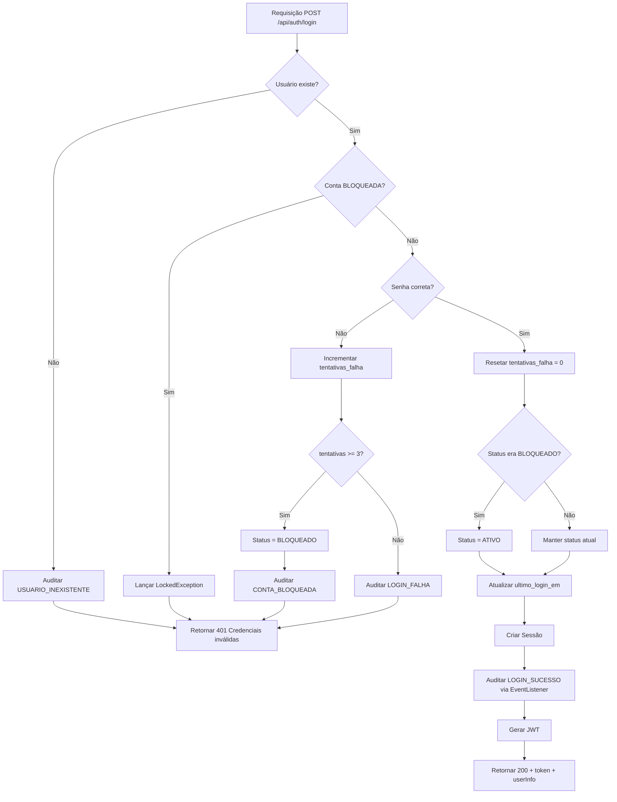

# AccessGuard

Sistema corporativo de IAM (Identity and Access Management) com RBAC, proteção contra força bruta e log de auditoria imutável.

## Visão Geral

O AccessGuard é uma aplicação Spring Boot que implementa controle de acesso baseado em papéis (RBAC), proteção automática contra ataques de força bruta com bloqueio de conta após 3 tentativas falhas, e trilha de auditoria completa de eventos de autenticação e autorização.

### Funcionalidades Principais

- **RBAC**: Três papéis — `ADMIN`, `AUDITOR`, `COLABORADOR`
- **Proteção contra Força Bruta**: Bloqueio automático após 3 tentativas de senha incorreta; desbloqueio apenas por administrador
- **Auditoria Imutável**: Log de todos os eventos (login sucesso/falha, conta bloqueada, usuário inexistente, ações administrativas)
- **Autenticação Stateless JWT**: API REST com tokens JWT (expiração 30 min)
- **Interface Web**: Thymeleaf com fragmentos reutilizáveis
- **Documentação OpenAPI/Swagger**: Disponível em `/swagger-ui.html`

## Stack Tecnológica

| Camada | Tecnologia |
|--------|------------|
| Framework | Spring Boot 3.3.x |
| Segurança | Spring Security 6, JWT (jjwt 0.12.5) |
| Persistência | Spring Data JPA, Hibernate, PostgreSQL (produção) / H2 (testes) |
| Migração | Flyway |
| Template | Thymeleaf |
| Documentação | Springdoc OpenAPI 2.6 |
| Testes | JUnit 5, MockMvc, Testcontainers, REST Assured, Playwright |
| Build | Maven Wrapper |

## Diagrama: Fluxo de Bloqueio por Força Bruta



## Credenciais de Demonstração

| Email | Senha | Papel |
|-------|-------|-------|
| `admin@accessguard.com` | `Admin@123` | ADMIN |
| `auditor@accessguard.com` | `Auditor@123` | AUDITOR |
| `colab@accessguard.com` | `Colab@123` | COLABORADOR |

> Os usuários são criados automaticamente na primeira execução se o banco estiver vazio (`DataInitializer`).

## Endpoints e Rotas (RBAC)

### API REST (`/api/**`) — Autenticação via Bearer Token JWT

| Método | Rota | Papéis Permitidos | Descrição |
|--------|------|-------------------|-----------|
| POST | `/api/auth/login` | Público | Autentica e retorna JWT |
| POST | `/api/auth/logout` | Autenticado | Invalida contexto (stateless) |
| POST | `/api/auth/validate` | Autenticado | Valida token e retorna userInfo |
| GET | `/api/admin/usuarios` | ADMIN | Lista usuários paginada |
| POST | `/api/admin/usuarios` | ADMIN | Cria novo usuário |
| GET | `/api/admin/usuarios/{id}` | ADMIN | Busca usuário por ID |
| PUT | `/api/admin/usuarios/{id}` | ADMIN | Atualiza usuário |
| DELETE | `/api/admin/usuarios/{id}` | ADMIN | Exclui usuário |
| POST | `/api/admin/usuarios/{id}/desbloquear` | ADMIN | Desbloqueia conta bloqueada |
| GET | `/api/auditoria` | ADMIN, AUDITOR | Lista logs de auditoria paginada |
| GET | `/api/perfil` | Autenticado | Dados do usuário logado |
| PUT | `/api/perfil` | Autenticado | Atualiza nome/email próprio |
| PUT | `/api/perfil/senha` | Autenticado | Altera própria senha |

### Interface Web (Thymeleaf) — Sessão com Cookie

| Rota | Papéis Permitidos | Descrição |
|------|-------------------|-----------|
| `/login` | Público | Página de login |
| `/logout` | Autenticado | Logout |
| `/dashboard` | Todos autenticados | Painel principal |
| `/perfil` | Todos autenticados | Perfil do usuário |
| `/admin/usuarios` | ADMIN | Gestão de usuários |
| `/auditoria` | ADMIN, AUDITOR | Visualização de logs |

## Comandos

### Pré-requisitos
- Java 21+
- Docker (para PostgreSQL) ou PostgreSQL local na porta 5432

### Subir banco de dados (Docker)
```bash
docker compose up -d
```

### Rodar aplicação (desenvolvimento)
```bash
./mvnw spring-boot:run
```
Acesse: http://localhost:8080  
Swagger: http://localhost:8080/swagger-ui.html

### Rodar com perfil Docker (usa variáveis de ambiente do compose)
```bash
./mvnw spring-boot:run -Dspring-boot.run.profiles=docker
```

### Executar testes
```bash
# Testes unitários + integração
./mvnw test

# Build completo com Testcontainers (integração + contrato)
./mvnw verify
```

### Migrações Flyway
```bash
# Aplicar migrações (produção)
./mvnw flyway:migrate

# Limpar e reaplicar (cuidado: apaga dados)
./mvnw flyway:clean flyway:migrate
```

## Estrutura do Projeto

```
src/main/java/com/accessguard
├── api
│   ├── controller     # Controllers REST
│   └── dto            # Records de request/response
├── auditoria
│   ├── AuditService / AuditServiceImpl
│   └── AuthenticationAuditListener  # @Async event listener
├── config
│   ├── AsyncConfig              # @EnableAsync
│   └── DataInitializer          # Carga inicial de usuários
├── domain
│   ├── auditoria    # EventoAuditoria, LogAcesso, LogAcessoRepository
│   ├── sessao       # Sessao, SessaoRepository
│   └── usuario      # Usuario, Role, StatusUsuario, UsuarioRepository
├── security
│   ├── AccessGuardUserDetails / UserDetailsService
│   ├── BruteForceAuthenticationProvider  # Provider customizado
│   ├── JwtUtil / JwtAuthenticationFilter
│   ├── SecurityConfig           # 2 SecurityFilterChain (api + web)
│   └── LoginSuccessHandler / LoginFailureHandler
└── web
    └── controllers    # Controllers Thymeleaf (Admin, Auditoria, Dashboard, Login, Perfil)
```

## Variáveis de Ambiente Principais

| Variável | Padrão | Descrição |
|----------|--------|-----------|
| `JWT_SECRET` | (chave fixa em application.yml) | Chave HMAC para assinar JWT (mín. 32 chars) |
| `SPRING_DATASOURCE_URL` | `jdbc:postgresql://localhost:5432/accessguard` | URL do banco |
| `SPRING_DATASOURCE_USERNAME` | `accessguard` | Usuário do banco |
| `SPRING_DATASOURCE_PASSWORD` | `accessguard` | Senha do banco |

## Observações de Segurança

- Senhas armazenadas com BCrypt (cost default 10)
- Tokens JWT expiram em 30 minutos (`accessguard.jwt.expiration`)
- Contas bloqueadas só podem ser desbloqueadas por ADMIN via `POST /api/admin/usuarios/{id}/desbloquear`
- Auditoria registra IP (considera `X-Forwarded-For`, `X-Real-IP`) e User-Agent
- API REST é stateless; interface web usa sessão com cookie HttpOnly

## Licença

Uso educacional / corporativo interno.